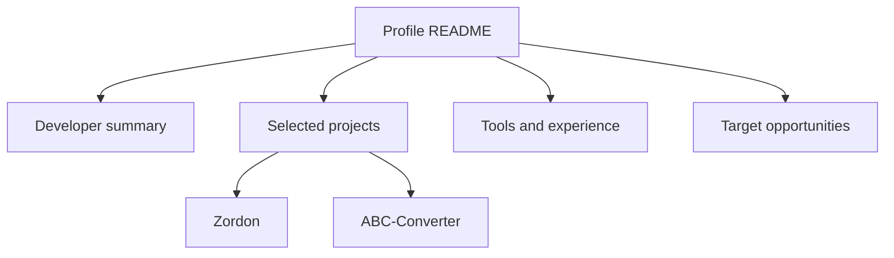

# JonesPride — Information Architecture

## Repository role
The documented repository is a human-facing developer profile. Its architecture is informational rather than a software runtime architecture.

## Content map

## Maintenance workflow
1. Keep the profile summary accurate.
2. Link project descriptions to their canonical repositories.
3. Verify claims against current project documentation and CI.
4. Label pending tests and planned features clearly.
5. Avoid presenting prototypes as finished production products.

## Not applicable / not documented
No application API, database, frontend runtime, CI pipeline, or deployment architecture is established by the README reviewed for this pass.